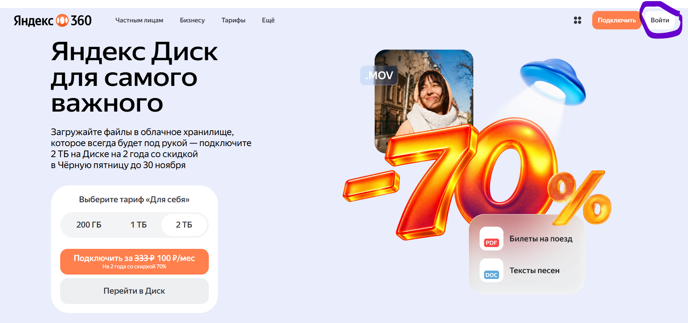
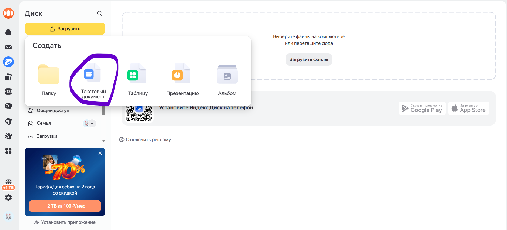
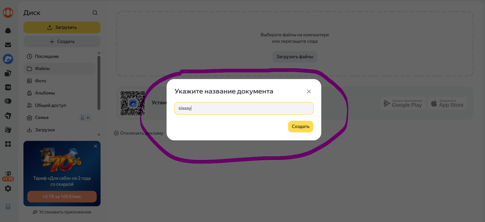
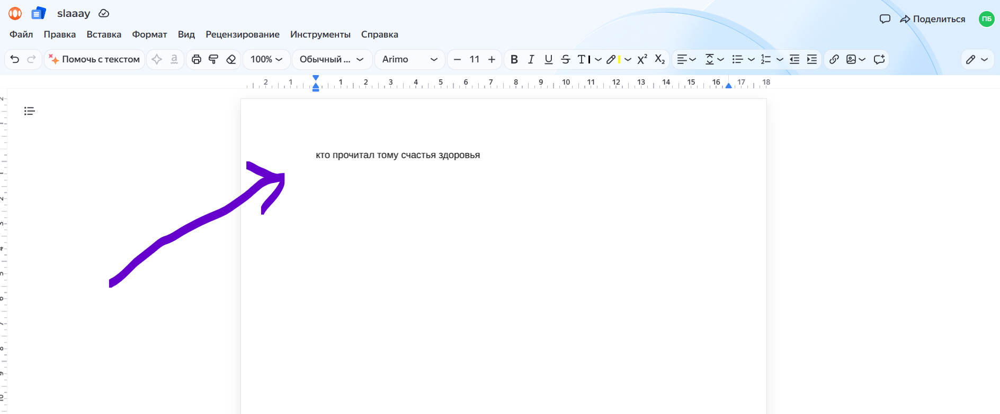
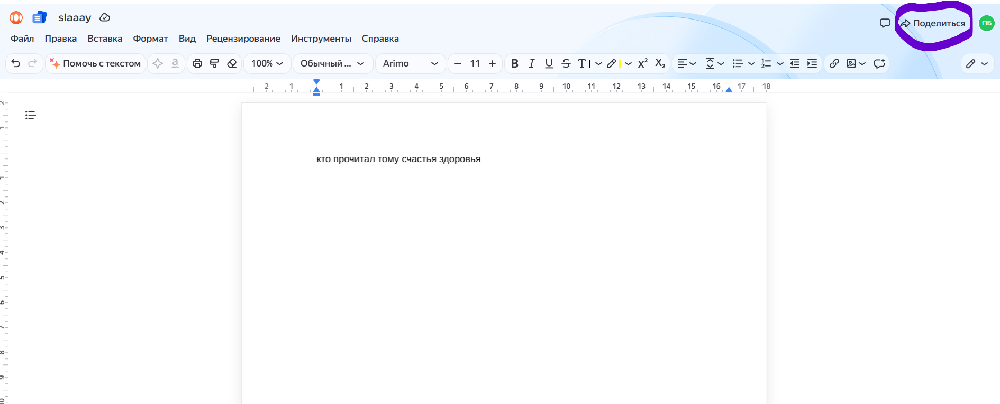
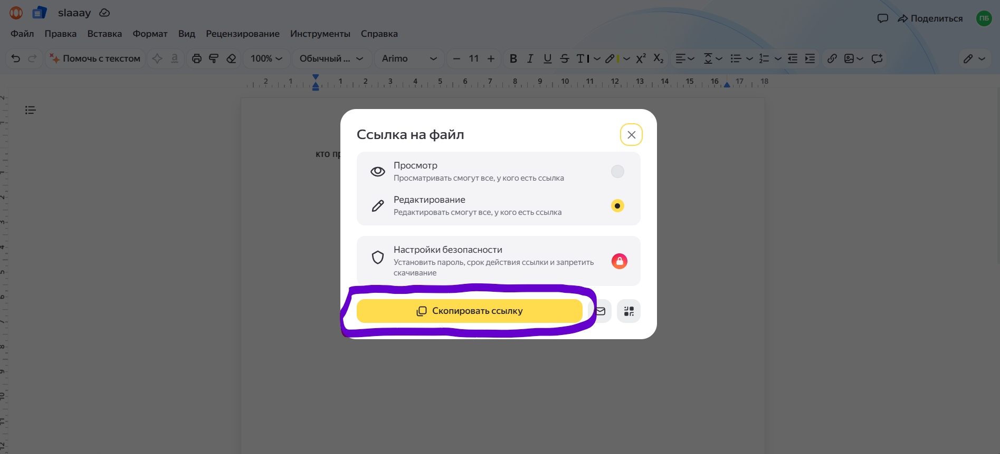
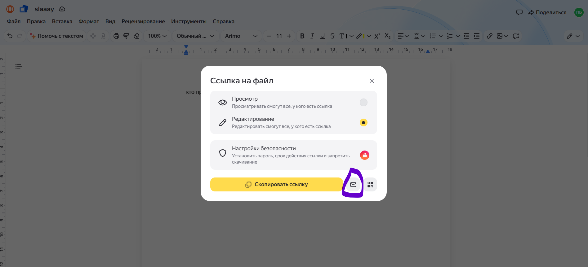
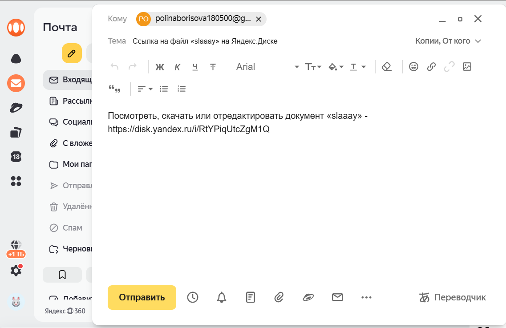
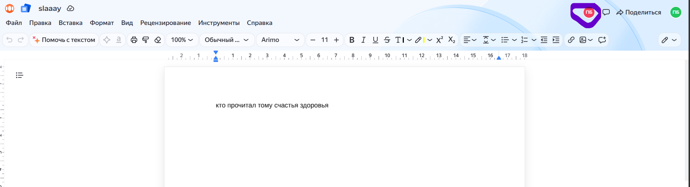

# Как создать документ и настроить совместный доступ в Яндекс.Диске

Инструкция поможет создать текстовый файл в облачном хранилище, открыть к нему доступ по ссылке и пригласить коллегу для совместного редактирования.

## Шаг 1. Откройте Яндекс.Диск
Перейдите на страницу [360.yandex.ru](https://360.yandex.ru) и авторизуйтесь в своем аккаунте.

## Шаг 2. Создайте текстовый документ
Нажмите кнопку **Создать** в левом верхнем углу экрана и выберите в выпадающем списке пункт **Текстовый документ**.

## Шаг 3. Переименуйте документ
В открывшейся вкладке редактора нажмите на текущее название файла в верхней панели, введите новое имя документа и нажмите клавишу **Enter**.

## Шаг 4. Добавьте текст
Кликните в рабочую область редактора и введите необходимый текст. Все изменения сохранятся автоматически.

## Шаг 5. Откройте окно настроек доступа
Вернитесь на вкладку с Яндекс.Диском, наведите курсор на созданный файл в списке и нажмите кнопку **Поделиться** (иконка со стрелкой).

## Шаг 6. Настройте доступ
В открывшемся окне выберите опцию **Редактирование** и нажмите кнопку **Скопировать ссылку**.

## Шаг 7. Напишите соавтору с правами на редактирование
Щелкните по иконке конверта и введите адрес электронной почты соавтора.

## Шаг 8. Отправьте соавтору письмо с ссылкой
В открывшемся окне нажмите кнопку **Отправить** в нижней части экрана.

## Шаг 9. Убедитесь, что соавтор видит файл
Вернитесь на вкладку с документом и убедитесь, что в верхней части экрана появилась аватарка соавтора.

